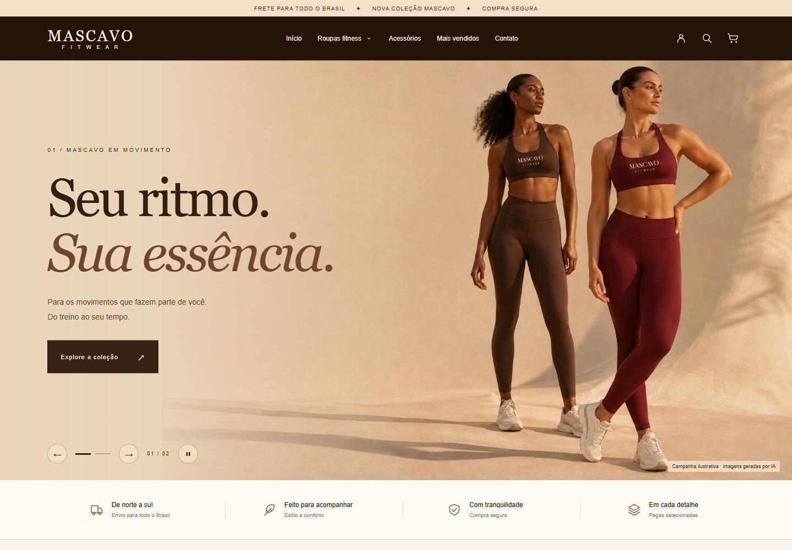
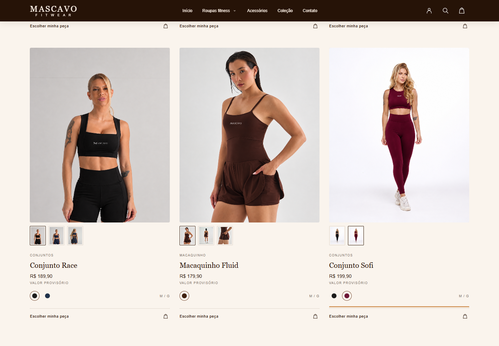
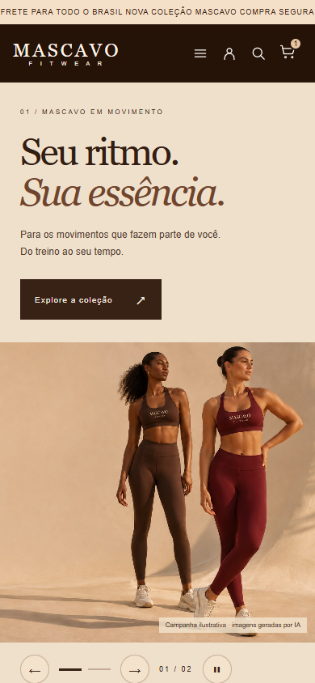
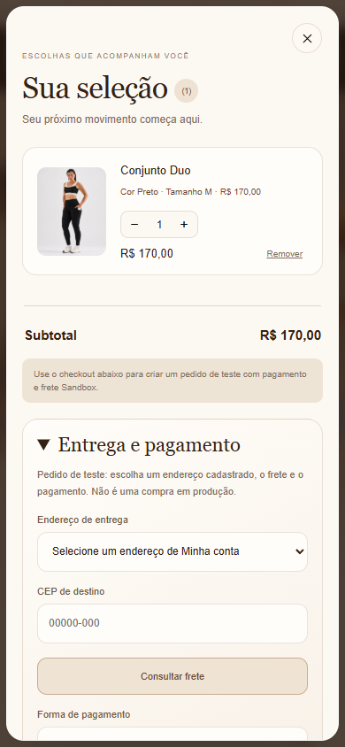
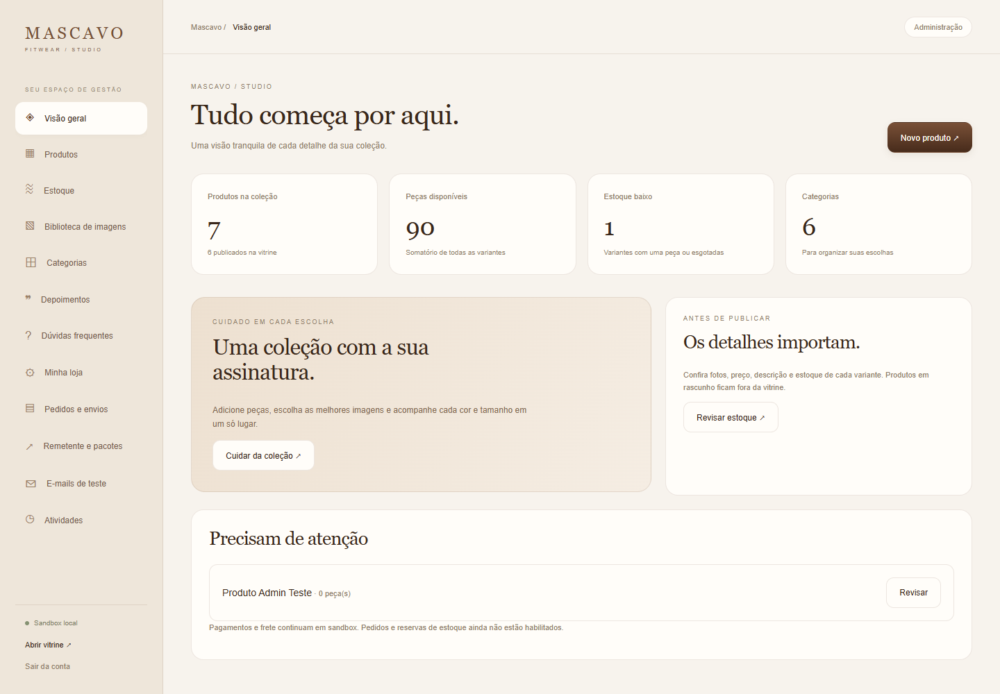

# Mascavo Fitwear

## Demonstração

Loja virtual de moda fitness com vitrine responsiva, catálogo de produtos, sacola e painel administrativo. As imagens abaixo são capturas do ambiente local de desenvolvimento; preços, estoque e informações de teste são ilustrativos. Pagamentos e fretes continuam em sandbox.

### Vitrine no computador

Página inicial com a identidade visual da Mascavo, campanha e navegação da loja.



### Catálogo de produtos

Exibição das peças com fotos, opções de cores, tamanhos e preços.



### Experiência no celular

Página inicial e sacola com consulta de entrega e pagamento de teste.

<p>
  
  
</p>

### Painel administrativo

Visão geral com indicadores e navegação para gestão de produtos, estoque, conteúdo e pedidos. Os dados exibidos pertencem ao ambiente de testes.



Para explorar o projeto, siga as instruções em [Executar localmente](#executar-localmente). As capturas ficam em [`docs/demo`](docs/demo) para serem exibidas diretamente no GitHub.

Conteúdo editorial: a seção de depoimentos na página inicial e a página `/duvidas-frequentes` são gerenciadas no painel, nas áreas **Depoimentos** e **Dúvidas frequentes**. Cadastros novos ficam em rascunho até marcar publicação. Consulte [ADMIN.md](ADMIN.md).

## Entrada da loja

A página inicial usa a logo oficial em um preloader breve, exibido uma vez por sessão da aba (`mascavo:entry:v1` no sessionStorage). Recarregar ou retornar à loja na mesma aba não repete a animação. Para rever, abra uma sessão nova ou remova somente essa chave no DevTools.

A linha acompanha a conclusão de três verificações: documento, logo e primeira imagem da campanha (incluindo decodificação). Não representa porcentagem de bytes e não espera imagens dos produtos. A entrada da logo dura 380 ms e a cortina de saída 520 ms, sem espera mínima adicional. Um watchdog independente libera o conteúdo em até 3,5 s mesmo se `preloader.js` falhar. Movimento reduzido elimina animações; Escape e o botão acessível por Tab permitem pular. Sem JavaScript, o conteúdo continua visível. Sem armazenamento, a entrada funciona sem persistir a preferência.

Arquivos: `preloader.css`, `preloader.js` e o bootstrap de segurança em `index.html`. Teste visual isolado: `node --test --test-name-pattern="^preloader:" tests/auth.test.mjs`.

Testes automatizados: execute `npm.cmd run check`. Comandos por integração, relatórios HTML, cobertura, sandbox opt-in e GitHub Actions estão documentados em [TESTING.md](TESTING.md). Pendências de funcionalidades ainda não implementadas aparecem separadas dos testes aprovados.

Painel administrativo: acesse `/admin` no servidor local. Veja [ADMIN.md](ADMIN.md) para habilitar a conta administradora e gerenciar produtos, variantes, estoque, imagens, categorias e configurações da loja.

Loja de moda fitness com frontend HTML/CSS/JavaScript e primeiro módulo de backend local em Cloudflare Workers + D1. R2 está configurado como binding local para a futura etapa de imagens.

## Identidade visual

- Creme: `#F2D7B6`
- Caramelo: `#BF8B5E`
- Café: `#261307`
- Chocolate: `#40210F`
- Marrom: `#73462D`

## Executar localmente

Requisitos: Node.js 24 ou superior e npm. No PowerShell com scripts bloqueados, utilize `npm.cmd` como nos exemplos abaixo.

```powershell
npm.cmd ci
npm.cmd run db:migrate
npm.cmd run dev
```

Abra **http://127.0.0.1:8787**. Use essa origem exata; Live Server e abertura por `file://` não oferecem a API de autenticação. Alterações nos arquivos públicos exigem executar `npm.cmd run assets:prepare` ou reiniciar o servidor.

Não é necessário fazer login na Cloudflare nem criar serviços remotos. Migrações e servidor usam somente recursos locais em `.wrangler/`. Não há comando de publicação nos scripts. O Worker também recusa origens remotas: homologação/produção dependerão de configuração própria e autorização.

## Estado

### Implementado neste marco

- Vitrine, categorias, variantes visuais e sacola originais preservadas.
- Cadastro, login, logout e consulta de sessão via API.
- Argon2id com salt individual de 16 bytes, memória de 19 MiB, duas iterações e paralelismo 1. Senhas de 12 a 128 caracteres no cadastro e recuperação.
- Sessões aleatórias de 256 bits, com hash no banco, revogação, limite absoluto de sete dias e inatividade de 24 horas.
- Cookies HttpOnly e SameSite=Lax; Secure e prefixo `__Host-` quando usado HTTPS. A exceção HTTP existe somente para desenvolvimento em loopback.
- CSRF, validação de origem, limite de corpo JSON, consultas parametrizadas e limitação de tentativas persistida no D1.
- Confirmação de e-mail e redefinição de senha com validade e uso único. Redefinir a senha revoga todas as sessões.
- Respostas genéricas em cadastro duplicado e recuperação de conta.
- Proteção contra tamanho adulterado no carrinho local.
- Somente arquivos públicos explicitamente permitidos são copiados para os assets; fontes do backend, configurações e segredos não são publicados.

O checkout permanece desabilitado. `POST /api/v1/orders` retorna 401 sem sessão válida e 503 com sessão: pedidos ainda não podem ser criados. Preços, imagens e disponibilidade da vitrine continuam demonstrativos. O carrinho permanece no navegador. Ainda não existem pagamentos, fretes, upload de imagens ou painel administrativo.

## E-mails de teste

Use exclusivamente dados fictícios, por exemplo `cliente@example.test`. Nenhum e-mail real é enviado. Após cadastrar ou solicitar recuperação:

```powershell
npm.cmd run mail:local
```

O comando mostra a caixa local com `purpose` (`verify` ou `reset`) e `token`. Copie o token para “Confirmar meu e-mail” ou “Já tenho código de recuperação”, no diálogo Minha conta. Para confirmar o e-mail após entrar, saia da conta e abra essa opção.

Tokens são guardados como hash em `auth_tokens`. A exceção é a **caixa simulada `dev_mail`**, que contém o token para permitir testes: ela existe apenas neste marco local, exige origem/CSRF e nunca deve receber dados reais ou ser usada em homologação/produção. A confirmação vence em 24 horas e a recuperação em 30 minutos. Uma nova recuperação invalida as anteriores.

## Verificar

```powershell
npm.cmd run check
npm.cmd run build:check
```

`check` executa TypeScript e testes de integração no workerd/D1, com banco isolado e dados sintéticos, mais testes no Google Chrome instalado. Não utiliza o banco de desenvolvimento. A suíte ocupa a porta 8791. Não é necessário baixar browsers do Playwright.

Os testes cobrem CSRF/origem, payloads, cadastro duplicado, hash de senha e sessão, confirmação de uso único, login/logout, expiração, recuperação, revogação, limite de tentativas e bloqueio do checkout. O navegador verifica sacola, cadastro, login, persistência de sessão, logout, filtro mobile e rejeição de carrinho adulterado.

Screenshots ficam em `test-results/`, com imagens ilustrativas substituídas por blocos locais para evitar dependência de rede. `build:check` empacota com `--dry-run`: não publica nada.

## Estrutura

```text
index.html / styles.css / script.js  frontend original
account.js                          integração da conta com API
backend/src/index.ts                entrada e proteção de ambiente local
backend/src/modules/auth/           rotas, sessões e criptografia
backend/migrations/                 schema versionado
scripts/                            assets e comandos locais
tests/                              integração de API e navegador
wrangler.jsonc                      bindings locais de Workers, D1 e R2
```

## Próximos passos

1. Catálogo em D1: categorias, produtos, cores, tamanhos, SKUs e preços em centavos; imagens no R2.
2. Carrinho no servidor, estoque por variante e reservas transacionais.
3. Pedidos autenticados com preços/estoque validados no servidor e histórico dos itens.
4. Asaas e Melhor Envio: concluir pedidos, webhooks e reconciliação após os testes de sandbox.
5. Administração com autorização própria e MFA, serviço real de e-mail, auditoria e recuperação de dados.
6. Homologação e revisão de segurança e desempenho na Cloudflare. Publicação somente com autorização explícita.

Consulte também [backend/SECURITY.md](backend/SECURITY.md) para os limites deste marco.

## Catalogo local

A vitrine consulta `GET /api/v1/catalog`. O catalogo e suas variantes ficam no D1 local, criados pela migracao `backend/migrations/0002_catalog.sql`. Esta migracao preserva os IDs 9 a 14, as fotos enviadas e os valores provisórios aprovados para testes. Precos sao armazenados em centavos; estoque e separado por cor e tamanho. Nao ha painel de administracao ou escrita publica no catalogo.

Depois de atualizar o projeto, execute `npm.cmd run db:migrate` antes de iniciar o servidor. A API aceita `?category=Conjuntos`; categorias conhecidas sem produtos retornam lista vazia. Falhas de carregamento exibem uma mensagem e botao para tentar novamente, sem recorrer a produtos demonstrativos.

A sacola ainda e local ao navegador e seu limite de quantidade serve apenas a demonstracao. Reserva de estoque e validacao de precos no checkout serao implementadas na etapa de pedidos; checkout continua desabilitado.

Teste do catalogo com banco isolado: `node --test --test-name-pattern="catalog:" tests/auth.test.mjs`.

## Perfil e enderecos

A conta autenticada oferece Meus dados (nome, CPF e telefone opcionais) e cadastro de ate dez enderecos com destinatario, CEP, rua, numero, complemento, bairro, cidade e UF. A migracao `0004_customer_profile.sql` adiciona as tabelas locais. Os endpoints `/api/v1/auth/profile` e `/api/v1/auth/profile/addresses` exigem sessao; escritas herdam protecao de origem e CSRF da autenticacao. Cada consulta, edicao e remocao de endereco e limitada ao titular. E-mail e senha continuam nos fluxos de autenticacao existentes.

Teste isolado: `node --test --test-name-pattern="profile:" tests/auth.test.mjs`. Dados permanecem locais; preenchimento de endereco e manual e nao ha consulta externa de CEP nesta etapa.

## Arara interativa (React + Tailwind)

O componente fornecido foi integrado em `components/ui/product-rail-gallery.tsx`, com entrada em `frontend/rail.tsx` e estilos em `frontend/rail.css`. Esta e uma ilha React dentro do HTML existente, sem migrar o Worker ou a loja inteira. A hero anterior foi preservada. O Conjunto Mix enviado como referencia nao foi cadastrado.

A secao usa a referencia Mix em preto e rosa: macaquinhos de peca unica, com shorts e costas fechadas. Ha vistas de frente, costas e lateral; as pecas comecam de perfil, viram ao passar o mouse e voltam ao sair. A selecao e visual, sem cadastro do Mix ou associacao a Fusion/Duo. Recursos: movimento ao passar o mouse e arrastar, giro frente/costas, teclado (setas, Enter, Escape, Tab), reducao de movimento e foco isolado no detalhe. As ilustracoes estao em `assets/rail/`, com prompts no README da pasta.

A estrutura shadcn esta definida em `components.json`, com alias `@/components/ui` e utilitario `lib/utils.ts`. Manter componentes reutilizaveis em `components/ui` permite imports consistentes e instalacoes futuras. React, React DOM, TypeScript, Tailwind e os utilitarios foram instalados; nao e necessario executar um novo scaffold. Para componentes futuros, a CLI pode usar esta configuracao com `npx shadcn@latest add <componente>`; revisar dependencias de cada componente antes de integrar.

O Tailwind gera apenas tema e utilitarios, sem Preflight, para preservar os estilos legados. `npm.cmd run assets:prepare` compila React e CSS para `dist/public/assets/rail-ui/` com esbuild e Tailwind. `npm.cmd run dev` ja executa essa preparacao. Apos editar TSX/CSS da arara, execute `npm.cmd run assets:prepare` novamente ou reinicie o servidor; nao ha watcher TSX separado.

`npm.cmd run typecheck` valida backend e frontend. Teste isolado: `node --test --test-name-pattern="rail:|catalog:|profile:" tests/auth.test.mjs`.

## Integrações sandbox: Asaas e Melhor Envio

1. Preencha `.dev.vars` (use `.dev.vars.example` como referência). Use somente chaves geradas nas contas sandbox. Não compartilhe chaves no chat ou no GitHub.
2. Configure o CEP de origem, o User-Agent com seu contato e as medidas/peso unitários para simulações. As medidas são iguais para todos os produtos nesta etapa.
3. Execute `npm.cmd run db:migrate` e `npm.cmd run dev`. Reinicie o servidor após mudar credenciais.
4. Entre na conta local da loja, adicione produtos à sacola e abra **Entrega e pagamento**. O usuário da loja é independente dos logins dos provedores.
5. Consulte o frete pelo CEP. Para gerar uma fatura sandbox Asaas, preencha antes um CPF de teste válido em **Minha conta**. O link da fatura permite escolher os meios habilitados na conta sandbox.

A sacola cria pedidos Sandbox com produtos e frete calculados no servidor. O navegador não define os valores cobrados. Escritas exigem sessão, origem e CSRF válidos. Hosts dos provedores são fixados em Sandbox. A expedição depende de pagamento conciliado, remetente, dimensões verificadas e nota fiscal.

Uma chave identifica cada tentativa e é persistida no pedido. A mesma chave não cria outra cobrança. Em falhas ou timeout, consulte Meus pedidos e o painel Asaas antes de iniciar outra compra. Clientes Asaas são criados com notificações do provedor desativadas; os e-mails de pedidos ficam na caixa local de testes.

Endpoints: `GET /api/v1/integrations/status`, `POST /api/v1/integrations/shipping/quote` (`items`, `cep`) e `POST /api/v1/integrations/payments` (`items`, `requestKey`). Cada item contém `id`, `color`, `size`, `qty`. A migração `0006_sandbox_payments.sql` registra tentativas de cobrança. Testes dos clientes HTTP: `node --test tests/integrations.test.mjs` (Node 26).

O checkout atual cria pedidos com reserva de estoque, total incluindo frete, conciliação de pagamento e expedição Melhor Envio. Os webhooks são publicados pelo proxy restrito do Cloudflare Tunnel. Consulte [COMMERCE-SANDBOX.md](COMMERCE-SANDBOX.md) para operar, cadastrar dados fiscais e configurar o aplicativo. Produção permanece desabilitada; e-mails usam caixa local.

Referências: https://docs.asaas.com/reference/criar-nova-cobranca e https://docs.melhorenvio.com.br/reference/calculo-de-fretes-por-produtos.


### Escolhas de entrega e pagamento

A migra??o `0007_checkout_choices.sql` armazena cota??es por cliente por dez minutos. O cliente escolhe o servi?o e v? o total com frete; qualquer mudan?a no CEP exige nova consulta. Altera??es de itens, variantes, quantidades ou pre?os invalidam a cota??o no servidor. A cobran?a usa apenas o pre?o do frete salvo no banco, nunca um valor enviado pelo navegador.

`POST /api/v1/integrations/payments` exige `items`, `requestKey`, `quoteId`, `serviceId`, `billingType` (`PIX`, `BOLETO`, `CREDIT_CARD`) e `installments` (1 a 3; Pix/boleto apenas 1). No cart?o parcelado, enviamos ao Asaas `installmentCount` e `totalValue`, preservando o total em centavos. O Asaas faz o ajuste final de arredondamento. Os dados do cart?o continuam sendo preenchidos na fatura segura do Asaas. A chave de tentativa fica vinculada ?s escolhas originais.
